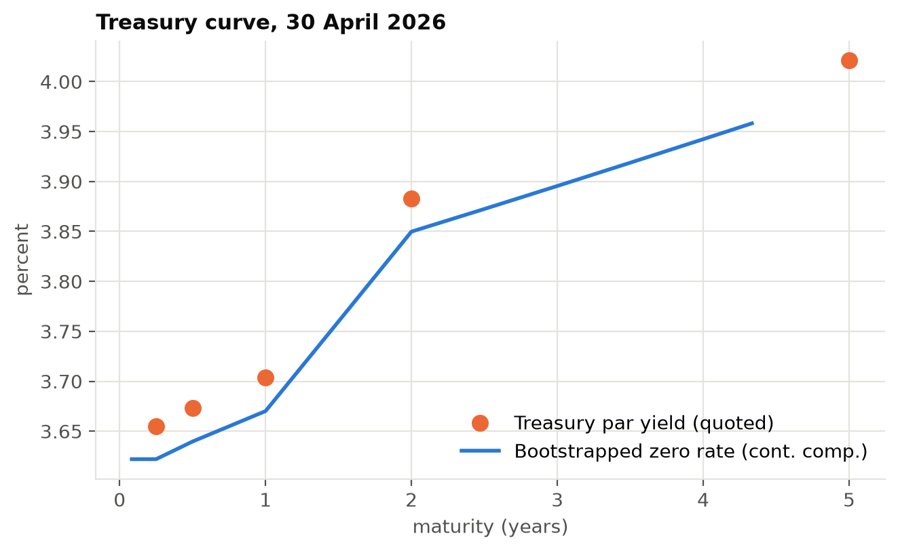
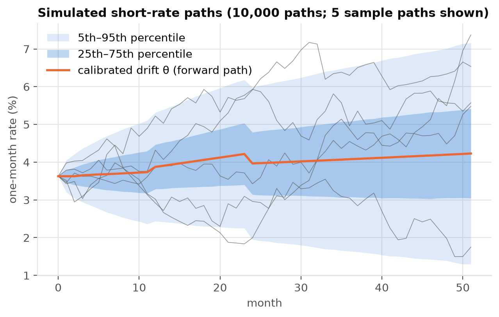
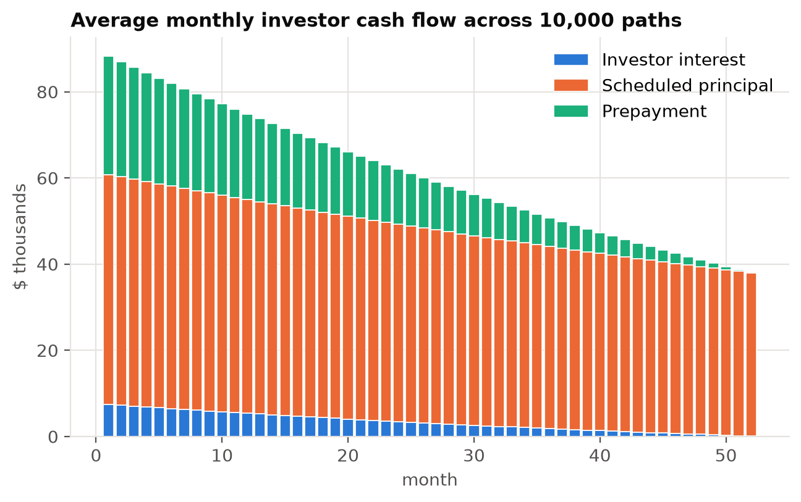
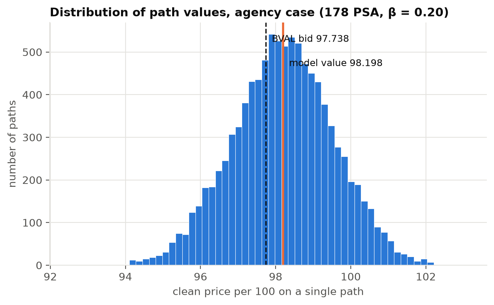
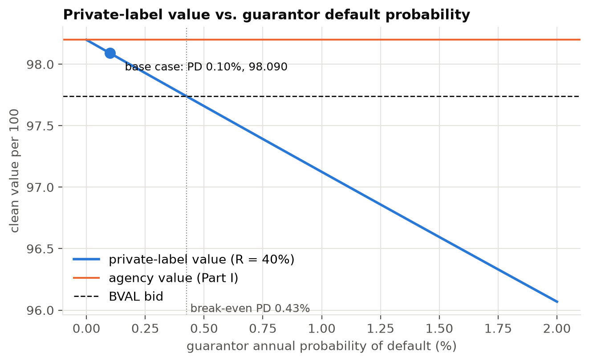
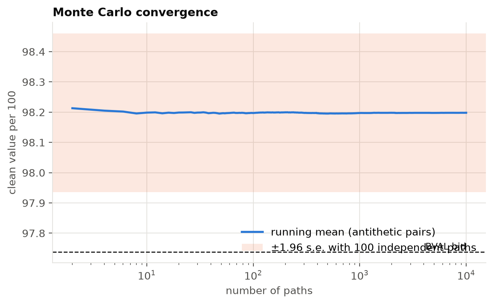

- **Security:** FN FS9548 Mtge (CUSIP 3140XRTE5), Fannie Mae UMBS conventional 15-year pool
- **Valuation date:** 30 April 2026 (Bloomberg BVAL, NY 4pm bid)
- **Method:** discrete monthly Monte Carlo, 10,000 interest-rate paths, implemented in Python
  (`notebooks/`) with a formula-by-formula Excel walk-through of one path (`excel/`)

# Executive Summary

FN FS9548 is valued under two guarantee assumptions. In **Part I** the U.S. government guarantees timely payment
of principal and interest, so the only risks are interest-rate and prepayment risk. In **Part II** the guarantor
is a private financial institution rated **A** by S&P, so the cash flows also carry the guarantor's credit risk.

The model simulates 10,000 monthly one-month Treasury rate paths. Their drift is calibrated so that the paths
reprice the 30 April 2026 Treasury zero curve exactly, and their volatility (25.2 bp per month) comes from ten
years of month-end 10-year Treasury yields. Prepayments follow Bloomberg's projected **178 PSA**, adjusted on each
path for the simulated change in rates. Each path's cash flows are discounted with that path's own cumulative
discount factors on the actual payment dates, and the security's value is the average across paths.

| | Part I: agency | Part II: private label (A) |
|---|---|---|
| Model value, clean, per 100 | **98.198** | **98.090** |
| Monte Carlo standard error | 0.0003 | 0.0003 |
| BVAL bid, clean | 97.738 | 97.738 |
| Model − market | **+0.460** | **+0.352** |
| OAS implied by the bid | 25.7 bp | 19.7 bp |

**Part I.** At a zero spread to Treasuries the model value is 0.46 points above the BVAL bid. Put differently, the
market price implies an **option-adjusted spread of about 26 bp**, against **17.9 bp** on Bloomberg's own model
(BAM TOAS). A positive OAS is normal for agency MBS, so the security is **fairly priced to slightly cheap**, not
mispriced. That conclusion is not certain. Across 100–300 PSA the OAS ranges from 18 bp to 39 bp, so the verdict
depends mainly on the prepayment assumption. Simulation noise is no longer a factor.

**Part II.** With a 0.10% annual default probability and 40% recovery for the A-rated guarantor, the expected
cash-flow adjustment lowers the value by **0.11 points** (about 6 bp of spread). The private-label value
stays above today's agency price unless the guarantor's annual PD exceeds about **0.43%**. Default
probabilities implied by market credit spreads for A-rated financials typically exceed that level, so the credit
adjustment shown here is a lower bound.

**Revision note.** This edition corrects the submitted report. The submitted model concluded the security was
*rich* (model 97.49 vs. market 97.74). That conclusion came mainly from discounting at the 10-year Treasury yield
instead of the Treasury curve over the pool's 1.9-year average life, and from using only 100 random paths.
The bridge in Section 5 reconciles the two results step by step.

# 1. Security Description and Data

| Input | Value | Use in the model |
|---|---|---|
| Pass-through coupon | 3.000% | Investor interest |
| WAC | 3.448% | Borrowers' scheduled payment |
| WAM (WARM) / WALA | 52 / 125 months | Projection horizon / PSA seasoning |
| Original / current balance | $5,238,307 / $2,986,518 | Factor 0.57013048 |
| Payment delay | 54 days (paid on the 25th of the following month) | Payment-date discounting |
| Bloomberg projected prepayment | 178 PSA (10.68% CPR) | Base case |
| Realised speeds | 1m 27.0%, 3m 20.1%, 6m 17.1%, 1y 15.5% CPR | Sensitivity |
| BVAL price | 97-23⅝ bid / 97-25⅝ ask | 97.73828 (clean) |
| BVAL yield / WAL / I-spread | 4.184% / 1.9 yrs / 31 bp | Cross-check |
| Bloomberg BAM TOAS | 17.9 bp | Benchmark for the OAS |
| Treasury actives curve | 3m 3.655%, 6m 3.673%, 1y 3.704%, 2y 3.883%, 5y 4.021%, 10y 4.387% | Zero curve |

The BVAL bid of 97-23⅝ converts to $97 + 23.625/32 = 97.73828$. BVAL prices are clean. Settlement on 30 April
carries 29 days (30/360) of accrued interest, $3\%/12 \times 29/30 \times 100 = 0.2417$. The model value of
the cash flows is therefore a *full* price, and accrued interest is subtracted before comparing with the quote.
The pool is a Fannie Mae Super pool issued in October 2024 from 2015-vintage 15-year loans. The "original WAM" of
64 months on the screen refers to the Super pool at issue, not to the underlying loans.

# 2. Part I Methodology: Agency MBS

## 2.1 Interest-rate paths (Step 1)

**Volatility.** Month-end GT10 yields from May 2016 to April 2026 give 119 monthly changes. Their sample standard
deviation is

$$\sigma_{monthly} = \text{stdev}(y_t - y_{t-1}) = 0.2521\% \;(25.2\text{ bp, or }87\text{ bp annualised}).$$

The 5 May 2026 print in the raw Bloomberg export is excluded because it falls after the valuation date and is
not a month-end.

**Treasury zero curve.** Bills (3m, 6m, 1y) are treated as zero-coupon yields. From 1.5 to 5 years, par yields are
linearly interpolated and discount factors are bootstrapped from the par-bond condition
$1 = \tfrac{y_n}{2}\sum_{k<n}P(t_k) + (1+\tfrac{y_n}{2})P(t_n)$. Monthly discount factors $P(0,t)$ come from
linear interpolation of continuously compounded zero rates.

**Short-rate model.** Let $r_k$ be the annualised one-month rate from month $k$ to $k+1$:

$$r_k^{(i)} = \max\left(0,\ \theta_k + \sigma W_k^{(i)}\right), \qquad W_k^{(i)} = \sum_{j=1}^{k} \varepsilon_j^{(i)}, \quad \varepsilon \sim N(0,1).$$

The starting rate $r_0$ is the one-month rate implied by the zero curve. Each drift term $\theta_k$ is solved month
by month so that the average simulated discount factor equals the Treasury discount factor,
$\frac{1}{N}\sum_i \prod_{j=0}^{k}(1+r^{(i)}_j/12)^{-1} = P(0,k+1)$. The maximum calibration error is $10^{-13}$.
Without this calibration, a driftless random walk prices even a Treasury strip incorrectly. With it, the model is
arbitrage-free against Treasuries, which is the adjustment Fabozzi describes for Monte Carlo MBS models. The
simulation uses 10,000 paths (5,000 antithetic pairs) with a fixed random seed, and the same paths are used for
every scenario.

## 2.2 Prepayment model (Step 2)

The **PSA benchmark** sets $CPR_t = 6\% \times \min(age_t,30)/30$ at 100 PSA, and the monthly rate is
$SMM_t = 1-(1-CPR_t)^{1/12}$. At a WALA of 125 months the pool is fully seasoned, so 178 PSA gives a
$10.68\%$ CPR and an SMM of $0.9368\%$.

**Why 178 PSA.** It is Bloomberg's forward projection for this pool. Realised speeds have been faster (258 PSA over
the past year). The pool's 3.45% WAC, however, is far below current mortgage rates, so refinancing is uneconomic
and prepayments come mainly from housing turnover. A forward projection below recent realised speeds is
therefore reasonable, and 258 PSA is included as a sensitivity.

**Refinancing overlay.** A pure PSA model gives the same cash flows on every path. With Treasury-calibrated paths
the Monte Carlo value then collapses to simple discounting on the zero curve, and the prepayment option is
worth nothing. The assignment asks for cash flows *along each path*, so the speed in month $t$ responds to the
simulated change in long rates, $\Delta_t = \sigma W_{t-1}$:

$$PSA_t = 178\% \times \min\left(1.75,\ \max\left(0.75,\ 1 - \beta\,\Delta_t/1\%\right)\right), \qquad \beta = 0.20.$$

A 100 bp rally raises the speed to about 214 PSA, and a 100 bp sell-off slows it to about 142 PSA (lock-in).
The response is deliberately modest because even a 150 bp rally leaves this pool out of the money.

## 2.3 Monthly cash flows (Step 3)

For each path $i$ and month $t = 1,\dots,52$, with beginning balance $B_{t-1}$ and remaining term $n_t = 53-t$:

| Item | Formula |
|---|---|
| Scheduled payment | $PMT_t = B_{t-1}\,\dfrac{WAC/12}{1-(1+WAC/12)^{-n_t}}$ |
| Investor interest | $B_{t-1} \times 3.00\%/12$ |
| Scheduled principal | $PMT_t - B_{t-1}\,WAC/12$ |
| Prepayment | $SMM_t\,(B_{t-1} - \text{scheduled principal}_t)$ |
| Cash flow to investor | investor interest + scheduled principal + prepayment |
| Ending balance | $B_t = B_{t-1} - \text{scheduled principal}_t - \text{prepayment}_t$ |

The 0.448% gap between the WAC and the coupon is the servicing and guarantee fee, retained before cash reaches
investors. The Excel workbook rebuilds path 1 with these formulas. Its price matches the Python price exactly.

## 2.4 Discounting and valuation (Step 4)

Each path is discounted with **its own cumulative** short-rate discount factors, evaluated on the actual payment
date: the 25th of the month after the accrual month, or $25/30$ of a month after the end of month $t-1$.

$$DF_t^{(i)} = \prod_{k=0}^{t-2}\frac{1}{1+r_k^{(i)}/12}\times\left(1+\frac{r_{t-1}^{(i)}}{12}\right)^{-25/30},\qquad
PV^{(i)} = \sum_{t=1}^{52} CF_t^{(i)}\,DF_t^{(i)},\qquad V = \frac{1}{N}\sum_{i=1}^{N} PV^{(i)}.$$

Value per 100 is $V/B_0 \times 100$ (a full price). The clean price is that minus 0.2417 of accrued interest.

# 3. Part I Results

| Result | Value |
|---|---|
| Model value, full / clean | 98.4397 / **98.1980** |
| Standard error (95% interval) | 0.0003 (98.1975 – 98.1985) |
| BVAL bid / mid | 97.7383 / 97.7695 |
| Model − bid / model − mid | **+0.4597** / +0.4285 |
| OAS at bid / at mid | **25.7 bp** / 23.9 bp |
| Bloomberg BAM TOAS | 17.9 bp |
| Effective duration / convexity (±25 bp) | 1.79 years / +5.5 |

**Sensitivity.** All rows use the same 10,000 paths (common random numbers), so differences reflect only the
assumption that changed:

| Prepayment speed | Clean value | Model − bid | OAS at bid |
|---|---|---|---|
| 100 PSA | 98.087 | +0.348 | 18.2 bp |
| 150 PSA | 98.159 | +0.420 | 22.9 bp |
| **178 PSA (base)** | **98.198** | **+0.460** | **25.7 bp** |
| 200 PSA | 98.229 | +0.490 | 27.9 bp |
| 258 PSA (1-year realised) | 98.307 | +0.569 | 34.1 bp |
| 300 PSA | 98.362 | +0.624 | 38.8 bp |

| Other assumption | Clean value | OAS at bid |
|---|---|---|
| β = 0 (pure PSA, no option) | 98.231 | 27.5 bp |
| β = 0.4 | 98.188 | 25.2 bp |
| Volatility × 0.5 / × 1.5 | 98.221 / 98.169 | 26.9 / 24.1 bp |

The value rises monotonically with the prepayment speed. That is expected for a discount security (price below
par): faster prepayments return principal at par sooner. The refinancing option costs about 3 cents (98.231 vs.
98.198), and a higher volatility lowers the value, which is consistent with the investor being short a
prepayment option. Both effects are small because the pool is deeply out of the money.

**Is the security fairly priced? Are we sure?** At a zero spread to Treasuries the model value exceeds the market
price by 0.46 points, so the security is *cheap relative to Treasuries*. That is normal for agency MBS. The spread
compensates investors for liquidity, model risk and prepayment uncertainty, so the right comparison is the OAS
against what similar pools earn. The market-implied OAS of about 26 bp is roughly 8 bp wider than Bloomberg's
own estimate, which points to **fair to slightly cheap**. We cannot be sure. The OAS spans 18–39 bp across
plausible prepayment speeds, Bloomberg's model differs from ours in its prepayment function and curve, and
β and the volatility are assumptions. Simulation error, by contrast, is now negligible (standard error 0.0003).

# 4. Part II: Private-Label MBS

## 4.1 Credit inputs

The guarantor is a hypothetical A-rated financial institution. Its credit inputs:

- **Annual PD: 0.10%.** S&P's long-run studies show 'A' issuers defaulting at roughly 0.05% over one year and
  about 0.4–0.5% cumulatively over five years. That is about 0.1% per year over this pool's 52-month life.
- **Recovery: 40%.** This is the standard senior unsecured assumption.
- **Hazard: constant**, so survival is $S_t = (1-PD)^{t/12}$. The monthly PD is $0.008337\%$, and the cumulative
  PD over 52 months is $0.433\%$.

## 4.2 Expected cash flows

If the guarantor survives month $t$, the investor receives the promised cash flow. If it defaults during month
$t$, the investor recovers $R$ times the outstanding principal claim and nothing afterwards:

$$E[CF_t] = S_t\,CF_t + (S_{t-1}-S_t)\,R\,B_{t-1}.$$

The expected cash flows on each path are discounted with the same path discount factors as in Part I.
*Correction:* the submitted model used $CF_t(S_t + R\,q_t)$, which applies recovery to a single month's cash flow
instead of to the outstanding balance. It also valued Part II on a different random draw from Part I, which is
why its private-label price (97.5371) came out *above* its agency price. Here both parts use identical paths, so
the private-label value is always below the agency value.

## 4.3 Results

| Result | Value |
|---|---|
| Private-label value, clean | **98.0899** |
| Agency value, clean | 98.1980 |
| Credit discount | **0.108 points** (≈ 6.0 bp of spread) |
| Private-label value − BVAL bid | +0.352 |
| OAS at the BVAL bid | 19.7 bp |
| Break-even annual PD (value = BVAL bid) | **0.43%** |

| Annual PD | R = 25% | R = 40% | R = 60% |
|---|---|---|---|
| 0.05% | 98.130 | 98.144 | 98.162 |
| **0.10%** | 98.062 | **98.090** | 98.127 |
| 0.25% | 97.859 | 97.928 | 98.020 |
| 0.50% | 97.522 | 97.659 | 97.842 |
| 1.00% | 96.851 | 97.125 | 97.489 |
| 2.00% | 95.527 | 96.069 | 96.791 |

**Comment.** Using historical A-rated default rates, the credit adjustment is small: about 0.11 points. Two
things keep it small. The pool's remaining life is short (WAL 1.9 years), and 40% of the outstanding claim is
recovered on default. On these assumptions a private-label version would still value above the agency's market
price. The conclusion is, however, very sensitive to the default probability. A PD of 0.43% a year or more is
enough to push the value below 97.74. Market-implied PDs for A-rated financials, backed out from CDS or bond
spreads, are usually well above that, because spreads also price default risk premia and illiquidity. The
expected cash-flow approach also ignores **wrong-way risk**: a mortgage guarantor is most likely to fail in a
housing downturn, which is exactly when its guarantee is needed. On a risk-neutral basis a private-label version
of this pool should therefore trade at a discount to the agency pool of at least several tenths of a point.

# 5. Reconciliation with the Submitted Model

The submitted Excel model reported 97.49 (rich). Starting from that method run with 10,000 paths, the bridge
below changes one element at a time:

| Step | Value per 100 |
|---|---|
| Submitted method: 10-year-yield random walk from 4.387%, $DF=(1+r_t/12)^{-t}$ | 97.511 |
| + path-wise cumulative discount factors | 97.488 |
| + short-rate paths calibrated to the Treasury zero curve | 98.419 |
| + actual payment dates (25th of following month) | 98.473 |
| − accrued interest (clean compared with clean) | 98.231 |
| + refinancing overlay (path-dependent cash flows) = **final** | **98.198** |

The **discount curve** drives the change. The submitted model discounted every cash flow at rates drifting
around the 10-year yield (4.39%). A security with a 1.9-year average life should be discounted on the 0–4 year
part of the curve (3.6–4.0%), and that alone moves the value by about +0.9. Separately, **100 random paths are
far too few**. Rerunning the submitted method with 20 different seeds gives values from 97.08 to 98.04
(standard deviation 0.27). That is why the submitted sensitivity table alternated between "rich" and "cheap"
from one PSA speed to the next, and why the submitted report quoted several inconsistent prices
(97.5371, 97.4949). It also used `RAND()`, so the workbook changed on every recalculation.

# 6. Limitations

- **One-factor rate model.** One-month rate shocks also stand in for changes in mortgage rates, so the yield
  curve moves in parallel. Linear interpolation of zero rates gives a forward curve with small steps at the 1y
  and 2y knots.
- **Volatility.** The volatility is historical, from the 10-year yield, rather than implied from swaptions or
  caps.
- **Prepayments.** The prepayment function (PSA plus a linear refinancing overlay) is simple next to dealer models
  with burnout, seasonality, turnover and credit effects. β is a judgement, not a calibration.
- **Credit inputs.** The Part II credit inputs are illustrative because the guarantor is hypothetical. A real
  analysis would calibrate the PD to the guarantor's CDS curve and model the correlation between guarantor
  default and mortgage losses.

# 7. Conclusion

As an agency MBS, FN FS9548 is worth **98.20** (clean) on a zero-spread Treasury basis, 0.46 points above its
BVAL bid of 97.74. The market price implies an OAS of about **26 bp**, close to but slightly above Bloomberg's
17.9 bp, so the pool looks **fairly priced to slightly cheap**. The judgement depends mainly on the prepayment
assumption. With an A-rated private guarantor and historical default rates, the value falls by only 0.11 points
to **98.09**. With market-implied default rates above about 0.43% a year, it would fall below today's agency
price, and wrong-way risk argues for a larger discount still.

**Reproducibility.** Every number in this report is produced by the notebooks in `notebooks/` (seed 2026).
The Excel workbook `excel/FN_FS9548_MBS_Pricing_Model.xlsx` shows one path with live formulas, and a check cell
confirms that it matches Python exactly.
